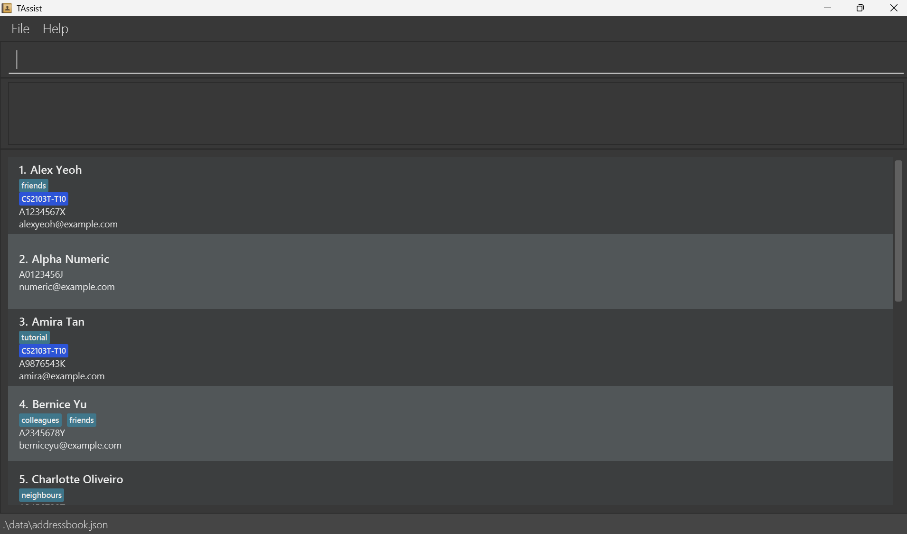
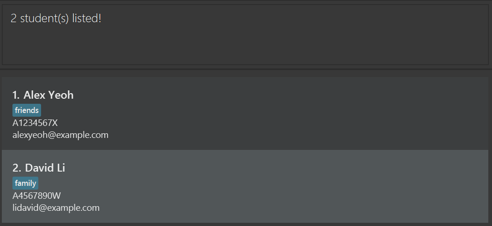

# TAssist User Guide

TAssist is a **desktop application for managing students, optimized for use through a Command Line Interface (CLI)** while retaining the benefits of a Graphical User Interface (GUI). If you type quickly, TAssist can help you manage students faster than traditional GUI applications.

<!-- * Table of Contents -->
<page-nav-print />

--------------------------------------------------------------------------------------------------------------------

## Quick start

1. Ensure that Java `25` or later is installed on your computer. 
   **Mac users:** Ensure you have the precise JDK version prescribed [here](https://se-education.org/guides/tutorials/javaInstallationMac.html).

1. Download the latest `.jar` file from [here](https://github.com/AY2627S1-CS2103T-T10-2/tp/releases).

1. Copy the file to the folder you want to use as the _home folder_ for your TAssist.

1. Open a terminal, `cd` to the folder containing the JAR file, and run `java -jar addressbook.jar`. 
   A GUI similar to the one below should appear in a few seconds. Note how the app contains some sample data. 
   

1. Type a command in the command box and press Enter to execute it. For example, type **`help`** and press Enter to open the help window. 
   Some example commands you can try:

   * `list` : Lists all students.

   * `add n/John Doe m/A1234567A e/johnd@example.com` : Adds a student named `John Doe` to TAssist.

   * `delete 3` : Deletes the 3rd student shown in the current list.

   * `clear` : Deletes all students.

   * `exit` : Exits the app.

1. Refer to the [Features](#features) section below for details of each command.

--------------------------------------------------------------------------------------------------------------------

## Features

<box type="info" seamless>

**Notes about the command format:** 

* Words in `UPPER_CASE` are the parameters to be supplied by the user. 
  For example, in `add n/NAME`, replace `NAME` with a value such as `John Doe`.

* Items in square brackets are optional. 
  For example, `n/NAME [t/TAG]` can be used as `n/John Doe t/friend` or as `n/John Doe`.

* Items followed by `...` can appear zero or more times. 
  For example, `[t/TAG]... ` may be omitted, or written as `t/friend` or `t/friend t/family`.

* Parameters can be in any order. 
  For example, if the command specifies `n/NAME m/MATRICULATION_NUMBER`, `m/MATRICULATION_NUMBER n/NAME` is also acceptable.

* Extraneous parameters for some of the commands that take no parameters, such as `help`, `exit`, and `clear`, are ignored. 
  For example, `help 123` is interpreted as `help`.

* Extraneous parameters for `list` will cause the command to be rejected.
  For example, `list a` is rejected.

* If you are using a PDF version of this document, be careful when copying and pasting commands that span multiple lines as space characters surrounding line-breaks may be omitted when copied over to the application.
</box>

### Viewing help: `help`

Shows a message explaining how to access the help page.

Format: `help`

### Adding a student: `add`

Adds a student to the address book.

Format: `add n/NAME m/MATRICULATION_NUMBER e/EMAIL [t/TAG]... `

<box type="tip" seamless>

**Tip:** A student can have any number of tags, including zero.
</box>

Examples:
* `add n/John Doe m/A1234567A e/johnd@example.com`
* `add n/Betsy Crowe t/friend e/betsycrowe@example.com m/A2345678A t/criminal`

### Listing all students: `list`

Shows a list of all students in the address book.

Format: `list`

### Editing a student: `edit`

Edits an existing student in the address book.

Format: `edit INDEX [n/NAME] [m/MATRICULATION_NUMBER] [e/EMAIL] [t/TAG]... `

* Edits the student at the specified `INDEX`. The index refers to the index number shown in the displayed student list. The index **must be a positive integer** 1, 2, 3, ...
* At least one of the optional fields must be provided.
* Existing values will be updated to the input values.
* When editing tags, all of the student's existing tags are removed; adding tags is not cumulative.
* To remove all of a student's tags, enter `t/` without a tag after it.

Examples:
*  `edit 1 m/A1234567A e/johndoe@example.com` Edits the matriculation number and email address of the 1st student to be `A1234567A` and `johndoe@example.com` respectively.
*  `edit 2 n/Betsy Crower t/` Edits the name of the 2nd student to be `Betsy Crower` and clears all existing tags.

### Locating students by name: `find`

Finds students whose names contain any of the given keywords.

Format: `find KEYWORD [MORE_KEYWORDS]`

* The search is case-insensitive; for example, `hans` matches `Hans`.
* Keyword order does not matter; for example, `Hans Bo` matches `Bo Hans`.
* The search considers only names.
* Both partial and full words match; for example, `Han` matches `Hans`.
* Students matching at least one keyword are returned (an `OR` search); for example, `Hans Bo` returns `Hans Gruber` and `Bo Yang`.

Examples:
* `find John` returns `john` and `John Doe`
* `find alex david` returns `Alex Yeoh`, `David Li` 
  
* `find august` returns `August` and `Augustine`

### Viewing a student's details: `view`

Displays the selected student's details, including their matriculation number and recorded attendance dates.

Format: `view INDEX`

* The index refers to the number shown in the displayed student list.
* Each detail appears on its own line in the result panel.
* Attendance dates are listed from newest to oldest. If no dates have been recorded, the result shows `None recorded`.

Example: `view 1` displays the first student in the current list.

### Deleting a student: `delete`

Deletes the specified student from the address book.

Format: `delete INDEX`
or
`delete m/MATRICULATION_NUMBER`

* Deletes the student at the specified `INDEX` or with the specified `MATRICULATION_NUMBER`.
* The index refers to the index number shown in the displayed student list.
* The index **must be a positive integer** 1, 2, 3, ...
* The matriculation number must start with `A`, followed by 7 digits, and end with a letter.
* The matriculation number is case-insensitive.

Examples:
* `list` followed by `delete 2` deletes the 2nd student in the address book.
* `find Betsy` followed by `delete 1` deletes the 1st student in the results of the `find` command.
* `delete m/A1234567X` deletes the student whose matriculation number is `A1234567X`.

### Sorting students by name: `sort`

Sorts the displayed list of students by name in alphabetical order (A-Z).

Format: `sort`

* The sorting is case-insensitive; for example, `alice` is placed before `Bob`.
* The sort only changes how the list is displayed. Your saved data and the original order of students are not affected.
* Commands that use an `INDEX`, such as `delete`, `edit` and `view`, use the index number shown in the sorted list.
* If you use `find` while the list is sorted, the results are also sorted by name.

Examples:
* `sort` followed by `delete 1` deletes the student who appears first in the sorted list.

### Marking attendance: `attendance`

Marks the specified student present on the given date.

Format: `attendance INDEX [d/DATE]`

* Marks the student at the specified `INDEX` present on `DATE`.
* The index refers to the index number shown in the displayed student list.
* The index **must be a positive integer** 1, 2, 3, ...
* `DATE` must be in `dd-MM-yyyy` format. If omitted, today's date is used.
* Marking a date already recorded for that student shows an error and changes nothing.

Examples:
* `attendance 1 d/07-10-2026` marks the 1st student in the displayed list present on `07-10-2026`.
* `find Betsy` followed by `attendance 1` marks the 1st student in the results of the `find` command present on today's date.

### Filtering students by class/module: `filter`

Filter students whose modules or classes contain any of the given keywords.

Format: `filter KEYWORD [MORE_KEYWORDS]`

* The search is case-insensitive; for example, `cs2103t` matches `CS2103T`.
* `KEYWORD` must be either a `MODULE` or `CLASS`
* `MODULE` is a module code: 2 to 3 letters, followed by 4 digits and an optional suffix of up to 2 letters (e.g. `CS2103T`), with no spaces.
* `CLASS` is a full class code in the format `MODULE-GROUP` (e.g. `CS2103T-T10`). `GROUP` contains 1 to 5 letters or digits, with no spaces or symbols.
* Only full words match; for example, `CS2103` does not match `CS2103T`.
* Students matching at least one keyword are returned (an `OR` search); for example, `CS2103T CS2103` returns students taking `CS2103T` and students taking `CS2103`.

Examples:
* `filter CS2103` returns students in `CS2103`.
* `filter CS2103T-T10 CS3230` returns students in `CS2103T-T10` tutorial group, as well as all students enrolled in the module `CS3230`.

### Clearing all entries: `clear`

Clears all entries from the address book.

Format: `clear`

### Exiting the program: `exit`

Exits the program.

Format: `exit`

### Saving the data

TAssist automatically saves data after every command. You do not need to save manually.

### Editing the data file

TAssist data is saved automatically as a JSON file `[JAR file location]/data/addressbook.json`. Advanced users are welcome to update data directly by editing that data file.

<box type="warning" seamless>

**Caution:**
If TAssist cannot read or validate the saved student or attendance records, it displays the failure reason and recovery instructions, disables the command box, and blocks all commands. The original data file remains unchanged, including when you close the app. 
Close TAssist using the window's close button. Correct the data file, replace it with a valid backup, or delete it to start with sample student records. Then reopen TAssist. Commands remain blocked until you reopen the app, even if you correct the file while it is running. 
If no data file exists, TAssist starts with sample student records and accepts commands. Back up your data file before editing it. 
Furthermore, certain edits can cause TAssist to behave in unexpected ways (e.g., if a value entered is outside of the acceptable range). Therefore, edit the data file only if you are confident that you can update it correctly.
</box>

### Archiving data files `[coming in v2.0]`

_Details coming soon ..._

--------------------------------------------------------------------------------------------------------------------

## FAQ

**Q**: How do I transfer my data to another computer? 
**A**: Install the app on the other computer and overwrite the data file it creates with the data file from your previous TAssist home folder.

--------------------------------------------------------------------------------------------------------------------

## Known issues

1. **When using multiple screens**, if you move the application to a secondary screen, and later switch to using only the primary screen, the GUI will open off-screen. The remedy is to delete the `preferences.json` file created by the application before running the application again.
2. **If you minimize the Help Window** and then run the `help` command (or use the `Help` menu, or the keyboard shortcut `F1`) again, the original Help Window will remain minimized, and no new Help Window will appear. The remedy is to manually restore the minimized Help Window.

--------------------------------------------------------------------------------------------------------------------

## Command summary

Action     | Format, Examples
-----------|----------------------------------------------------------------------------------------------------------------------------------------------------------------------
**Add**    | `add n/NAME m/MATRICULATION_NUMBER e/EMAIL [t/TAG]... `   e.g., `add n/James Ho m/A1234567A e/jamesho@example.com t/friend t/colleague`
**Attendance** | `attendance INDEX [d/DATE]`  e.g., `attendance 1 d/07-10-2026`
**Clear**  | `clear`
**Delete** | `delete INDEX`  e.g., `delete 3`
**Edit**   | `edit INDEX [n/NAME] [m/MATRICULATION_NUMBER] [e/EMAIL] [t/TAG]... `  e.g.,`edit 2 n/James Lee e/jameslee@example.com`
**Find**   | `find KEYWORD [MORE_KEYWORDS]`  e.g., `find James Jake`
**List**   | `list`
**Sort**   | `sort`
**Filter** | `filter KEYWORD [MORE_KEYWORDS]`  e.g., `filter CS2103T-T10 CS3230`
**Help**   | `help`
