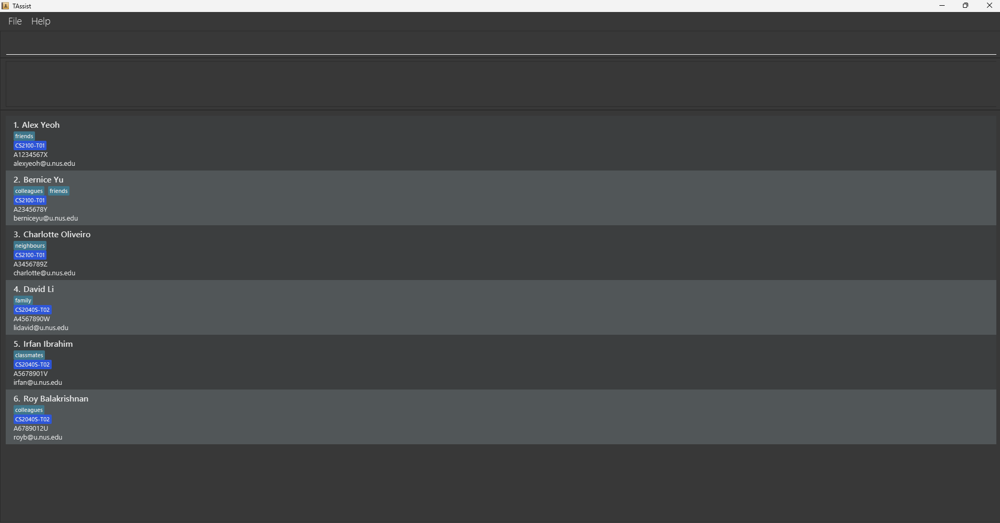

# TAssist User Guide

TAssist is a **desktop application for managing students, optimized for use through a Command Line Interface (CLI)** while retaining the benefits of a Graphical User Interface (GUI). If you type quickly, TAssist can help you manage students faster than traditional GUI applications.

<!-- * Table of Contents -->
<page-nav-print />

--------------------------------------------------------------------------------------------------------------------

## Quick start

1. Ensure that Java `25` is installed on your computer. Run `java -version` in a terminal to check that Java 25 is selected.<br>
   **Mac users:** Ensure you have the precise JDK version prescribed [here](https://se-education.org/guides/tutorials/javaInstallationMac.html).

1. Download the latest `.jar` file from [here](https://github.com/AY2627S1-CS2103T-T10-2/tp/releases).

1. Copy the file to the folder you want to use as the _home folder_ for your TAssist.<br>
   Choose a folder where you have permission to create and update files. TAssist cannot save your records and preferences properly in a write-protected folder.

1. Open a terminal, `cd` to the folder containing the JAR file, and run `java -jar "addressbook.jar"`. If your downloaded file has a different name, substitute that filename inside the quotes.<br>
   Double-clicking the JAR file may not work on some systems. Use the terminal command above to launch TAssist.<br>
   Only one TAssist instance can run from the same home folder. If it is already open, use the existing window or close it before launching again.<br>
   A GUI similar to the one below should appear in a few seconds. The six sample students use `@u.nus.edu` emails and are enrolled in CS2100-T01 or CS2040S-T02, with attendance, participation and quiz records. Try `view 1` to explore a profile; Roy's quiz is unmarked. Samples are loaded only when no saved data file exists.<br>
   

1. Type a command in the command box and press Enter to execute it. For example, type **`help`** and press Enter to open the help window.<br>
   Some example commands you can try:

   * `list` : Lists all students.

   * `add n/John Doe m/A1234567A e/johnd@example.com` : Adds a student named `John Doe` to TAssist.

   * `delete 3` : Deletes the 3rd student shown in the current list.

   * `clear` : Deletes all students and their associated records, all shared assignment definitions, and all recorded marks.

   * `exit` : Exits the app.

1. Refer to the [Features](#features) section below for details of each command.

--------------------------------------------------------------------------------------------------------------------

## Features

<box type="info" seamless>

**Notes about the command format:**<br>

* Words in `UPPER_CASE` are the parameters to be supplied by the user.<br>
  For example, in `add n/NAME`, replace `NAME` with a value such as `John Doe`.

* Items in square brackets are optional.<br>
  For example, `n/NAME [t/TAG]` can be used as `n/John Doe t/friend` or as `n/John Doe`.

* Items followed by `...` can appear zero or more times.<br>
  For example, `[t/TAG]... ` may be omitted, or written as `t/friend` or `t/friend t/family`.

* Parameters with a prefix, such as `n/NAME` or `c/MODULE-CLASS`, can be in any order.<br>
  For example, if the command specifies `n/NAME m/MATRICULATION_NUMBER`, `m/MATRICULATION_NUMBER n/NAME` is also acceptable.

* Parameters without a prefix, such as `INDEX`, and subcommand words, such as `unmark`, must be in the position shown in the format.<br>
  For example, `attendance 1 c/CS2100-T01` is accepted, but `attendance c/CS2100-T01 1` is rejected.

* A mistyped subcommand word is read as a student identifier.<br>
  For example, `attendance stat c/CS2103T-T10 d/07-10-2026` (instead of `stats`) shows `Specify the student by either INDEX or m/MATRICULATION_NUMBER.`, followed by command usage. If you intended a subcommand, check its spelling.
  When a matriculation number is also supplied, `attendance unmrk m/A1234567X c/CS2100-T01 d/01-09-2026` (instead of `unmark`) shows `Specify the student by either INDEX or m/MATRICULATION_NUMBER, not both.`, followed by command usage.

* Commands accepting either `INDEX` or `m/MATRICULATION_NUMBER` require the `m/` prefix for matriculation numbers.<br>
  For example, `mark A1234567X id/CS2103T:A1 mark/5` is rejected with guidance explaining both identifier forms and command usage. Use `mark m/A1234567X id/CS2103T:A1 mark/5` or a displayed index instead. Numeric-looking invalid indexes, such as `0`, `-1`, and `1.5`, retain index-specific errors.

* Extraneous parameters for some of the commands that take no parameters, such as `help`, `exit`, and `clear`, are ignored.<br>
  For example, `help 123` is interpreted as `help`.

* Extraneous parameters for `list` will cause the command to be rejected.
  For example, `list a` is rejected.

* If you are using a PDF version of this document, be careful when copying and pasting commands that span multiple lines as space characters surrounding line-breaks may be omitted when copied over to the application.
</box>

### Viewing help: `help`

Shows a message explaining how to access the help page.


Format: `help`


### Adding a student: `add`

Adds a student to the address book.

Format: `add n/NAME m/MATRICULATION_NUMBER e/EMAIL [t/TAG]... `

The email address must follow the [email constraints](#email-constraints) below.

<box type="tip" seamless>

**Tip:** A student can have any number of tags, including zero.
</box>

Examples:
* `add n/John Doe m/A1234567A e/johnd@example.com`
* `add n/Betsy Crowe t/friend e/betsycrowe@example.com m/A2345678A t/criminal`

### Listing all students: `list`

Shows a list of all students in the address book.

Students appear in alphabetical name order. `list` clears any active `find`, `filter` and sort.

Format: `list`

### Editing a student: `edit`

Edits an existing student in the address book.

Format: `edit INDEX [n/NAME] [m/MATRICULATION_NUMBER] [e/EMAIL] [t/TAG]... `

* Edits the student at the specified `INDEX`. The index refers to the index number shown in the displayed student list. The index **must be a positive integer** 1, 2, 3, ...
* At least one of the optional fields must be provided.
* Existing values will be updated to the input values.
* An updated email address must follow the same [email constraints](#email-constraints) as `add`.
* When editing tags, all of the student's existing tags are removed; adding tags is not cumulative.
* To remove all of a student's tags, enter `t/` without a tag after it.

Examples:
*  `edit 1 m/A1234567A e/johndoe@example.com` Edits the matriculation number and email address of the 1st student to be `A1234567A` and `johndoe@example.com` respectively.
*  `edit 2 n/Betsy Crower t/` Edits the name of the 2nd student to be `Betsy Crower` and clears all existing tags.

### Locating students by name or matriculation number: `find`

Finds students by name keywords or a full matriculation number.

The results appear in alphabetical name order. A new `find` clears the previous sort.

**Search by name**

Format: `find KEYWORD [MORE_KEYWORDS]...`

* Name matching is case-insensitive.
* Keyword order does not matter.
* Both partial and full words match.
* Students matching at least one keyword are returned.
* This form searches names only.
* If a `filter` is active, the name search and the filter apply together, so only students matching both are shown. This works in either order.
* A new name search replaces the previous one.

Examples:

* `find John` returns students whose names contain `John`.
* `find alex david` returns students whose names contain `alex` or `david`.
* `find august` matches names such as `August` and `Augustine`.
* `filter CS3230` followed by `find John` returns only students named `John` who are in `CS3230`.

**Search by matriculation number**

Format: `find m/MATRICULATION_NUMBER`

* Enter one complete matriculation number: `A`, followed by 7 digits, and a final letter.
* Matriculation number matching is exact and case-insensitive.
* The search covers all students. Any active `filter` or name search is cleared, not just bypassed for this search.
* A valid matriculation number with no matching student produces zero results.
* Do not combine name keywords with a matriculation number or repeat the `m/` prefix.

Examples:

* `find m/A1234567X` finds the student with matriculation number `A1234567X`, if present.
* `find m/a1234567x` performs the same search.

### Viewing a student's details: `view`

Opens a separate student details window showing particulars, enrolled classes and modules, assignment marks, attendance records with their dates and classes, and participation history.

Format: `view INDEX`

* The index refers to the number shown in the displayed student list.
* Details are organized into Particulars, Classes and modules, Assignments and marks, Attendance, and Participation sections.
* Classes are listed by module code and class group. Students without classes show `No classes enrolled`.
* Running `view` again updates the same window with the selected student's latest details, even when selecting the same student. Press `Esc` to close the window.
* While the window is open, successful changes to that student's particulars, class enrollments, attendance, assignments, marks, or participation records automatically refresh the displayed details without taking keyboard focus from the main window. Editing their matriculation number preserves the visible assignments and recorded marks.
* Deleting the displayed student or clearing all students closes the details window.
* Successful `undo` and `redo` also close the details window. Run `view` again to inspect the restored records. A manually closed window stays closed when later commands change the student or their marks.
* Finding, filtering, or sorting students keeps the window on the same student, even if that student is no longer in the displayed list. Changes to other students do not switch the window to another student.
* Attendance records show the date and class, ordered from newest to oldest, then by class code for records on the same date. If there are no attendance records, the Attendance section shows `None recorded`.
* The Participation section groups records by class code. Within each class, records are ordered by date, from earliest to latest. Each record shows its date and awarded points. If the student has no participation records, the section shows `None recorded`.
* The Assignments and marks section shows only assignments attached to the selected student, ordered by assignment ID. Each entry includes its ID, name, maximum mark, and score (for example, `Mark: 8.5/10`).
* An assignment without a recorded score shows `Mark: Unmarked`. A recorded zero shows a score such as `Mark: 0/10`. If the student has no assignments, the section shows `None assigned`.
* After `assignment`, `mark`, or `removeassignment` succeeds, the open window immediately shows the updated assignments and scores. You do not need to run `view` again.
* Use `marks id/MODULE:CODE` to see all students' results for one assignment.

Example: `view 1` displays the first student in the current list.

### Assigning work to a student: `assignment`

Creates an assignment definition and assigns it to one student, or assigns an existing definition to another student. Identify the student by their displayed index or matriculation number.

Format for new work: `assignment INDEX id/MODULE:CODE n/NAME max/MAX_MARK` or `assignment m/MATRICULATION_NUMBER id/MODULE:CODE n/NAME max/MAX_MARK`

Format for existing work: `assignment INDEX id/MODULE:CODE` or `assignment m/MATRICULATION_NUMBER id/MODULE:CODE`

* Specify exactly one student identifier: a positive displayed `INDEX` or `m/MATRICULATION_NUMBER`, never both.
* An index refers to the current displayed list, including searches, filters, and sorting. Zero, negative, malformed, and out-of-range indices are rejected without changing records.
* Matriculation numbers are case-insensitive and can target students hidden from the displayed list.
* `id/` identifies an assignment within a module, such as `CS2103T:A1`. IDs ignore letter case.
* Both forms require an existing student who is enrolled in the assignment's module. Use `enroll` to enroll the student first. Any class within that module qualifies; enrollment only in another module does not.
* A rejected assignment request changes no records, including when creating new work: neither the shared definition nor the student's assignment link is created.
* In the ID, `MODULE` has 2 or 3 letters, 4 digits, and up to 2 final letters (for example, `CS2103T`).
* `CODE` starts with a letter and then uses only letters and digits (for example, `A1`). Spaces are not allowed in the ID.
* `n/` gives the assignment a name. Names must not be blank and must be unique within a module, ignoring letter case and repeated spaces.
* `max/` is a positive numeric maximum mark; decimals are allowed.
* Values whose displayed decimal form would exceed 64 characters are rejected. This prevents very large or very precise values from slowing the app when it displays or saves them.
* The assignment begins without a recorded mark. A mark of zero, when later recorded, is different from an unmarked assignment.
* Both forms confirm the assignment's stored maximum, for example, `Assigned CS2103T:A1 (out of 20) to student A1234567X.`
* If that student's details window is open, the new assignment appears immediately with `Mark: Unmarked`.
* To assign the same work to another student, use its existing ID without `n/` or `max/`. Repeating the assignment for the same student reports an error and changes nothing.
* An existing ID or name cannot be used to create a second definition in the same module. A student and assignment ID must already exist when using the shorter form.
* Editing a student's matriculation number keeps their assignment links. Deleting that student removes their links but leaves the shared definition available for other students.
* Unenrolling a student keeps their existing assignments and marks. You may still record or update marks for that work, but assigning additional work or reattaching removed work requires enrollment in its module again. Previously saved assignment links without current module enrollment also remain available when loading data.

Examples:
* These examples assume both students are already enrolled in `CS2103T` using `enroll`.
* `assignment 1 id/CS2103T:A1 n/Assignment One max/20`
* `assignment 1 id/CS2103T:A1` attaches an existing definition to the first displayed student.
* `assignment m/A1234567X id/CS2103T:A1 n/Assignment One max/20`
* `assignment m/A2345678Y id/CS2103T:A1`

### Recording an assignment mark: `mark`

Records a student's numeric mark for work already assigned to them. Entering another mark for the same student and assignment updates the previous value. Use `mark` (singular) to record or update a score; `marks` (plural) only displays results. Use `attendance` to record attendance.

Format: `mark INDEX id/MODULE:CODE mark/MARK` or `mark m/MATRICULATION_NUMBER id/MODULE:CODE mark/MARK`

* Specify exactly one student identifier: a positive displayed `INDEX` or `m/MATRICULATION_NUMBER`, never both.
* An index refers to the current displayed list, including searches, filters, and sorting. Zero, negative, malformed, and out-of-range indices are rejected without changing records.
* Matriculation numbers are case-insensitive and can target students hidden from the displayed list.
* The student and assignment must exist, and the assignment must already be attached to that student using `assignment`.
* Existing assigned work can still be marked, including updating a previous mark, after the student is unenrolled from its module.
* `MARK` may be zero or a positive decimal, up to the assignment's maximum mark. A recorded `0` is different from an unmarked assignment.
* A score above the maximum is rejected with the actual limit, for example, `Mark cannot exceed the maximum mark of 10.` For a decimal maximum of `10.25`, the message ends with `10.25.` Maximums use plain decimal notation. Rejection preserves the previous score, assignment data, and saved records.
* A mark's displayed decimal form must also fit within 64 characters.
* The confirmation includes the score and maximum mark. Updating a recorded score gives a short updated message.
* If that student's details window is open, its score updates immediately after the command succeeds, without another `view` command.
* With a student identifier supplied, a missing `id/` or `mark/` prefix is named in the error, followed by command usage. For example, `mark m/A1234567X i/CS2103T:A1 mark/5` reports `Missing required prefix: id/`. Use `id/` for the assignment ID. Rejected commands leave marks unchanged.
* Use `mark` to change a score; `edit` changes student details and does not accept marks.

Examples:
* `mark 1 id/CS2103T:A1 mark/10`
* `mark m/A1234567X id/CS2103T:A1 mark/17.5`
* `mark m/A1234567X id/CS2103T:A1 mark/0`

### Viewing an assignment's marks: `marks`

Shows one assignment's name, maximum mark, and every student to whom it is assigned.

Format: `marks id/MODULE:CODE`

* Students are listed by matriculation number, including those hidden by the current search or filter. The displayed student list does not change.
* Each row shows the matriculation number, current student name, and either `MARK/MAX_MARK` or `Unmarked`. A recorded `0` appears as `0/MAX_MARK`.
* If no students have been assigned the work, the result shows `None assigned.`. An unknown assignment ID gives an error.

Example: `marks id/CS2103T:A1` may show:

```text
Assignment: CS2103T:A1 - Assignment One (out of 20)
Student marks:
A1234567X - John Doe: 17.5/20
A2345678Y - Jane Tan: Unmarked
```

### Removing an assignment: `removeassignment`

Removes an assignment from one student, or removes the shared assignment and all students' marks for it.

Format for one student: `removeassignment id/MODULE:CODE m/MATRICULATION_NUMBER`

Format for all students: `removeassignment id/MODULE:CODE`

* With `m/`, only that student's assignment link and recorded mark are removed. The shared assignment stays available for other students and can be assigned to this student again.
* Without `m/`, the assignment definition and every student's link and mark for it are removed. You can then create a new assignment using the same ID or name.
* Neither form deletes or edits student details, other assignments, or their marks. The student is found by matriculation number even if hidden from the current list.
* An affected student's open details window immediately removes the assignment. If no assignments remain, it shows `None assigned`.
* An unknown assignment or student, or an assignment not attached to the specified student, gives an error without changing records. A successful removal is saved in TAssist's data file and can be undone during the current session using `undo`. There is no separate assignment archive.

Examples:
* `removeassignment id/CS2103T:A1 m/A1234567X`
* `removeassignment id/CS2103T:A1`

### Deleting students: `delete`

Deletes one or more students by their displayed indices, or one student by matriculation number.

Format: `delete INDEX [MORE_INDICES]...`
or
`delete m/MATRICULATION_NUMBER`

**Deleting by index**

* Each index refers to the number shown in the currently displayed student list.
* Each index must be a positive integer within the displayed list.
* You can specify multiple indices separated by spaces.
* All indices refer to the displayed list before any students are deleted.
* If any index is invalid or repeated, no students are deleted.

**Deleting by matriculation number**

* Deletes the student with the specified matriculation number.
* The matriculation number must start with `A`, followed by 7 digits, and end with a letter.
* The matriculation number is case-insensitive.
* Only one matriculation number can be specified per command.

Do not combine indices with a matriculation number in the same command.

Examples:
* `list` followed by `delete 2` deletes the 2nd student in the displayed list.
* `find Betsy` followed by `delete 1` deletes the 1st student in the results of the `find` command.
* `delete 1 3` deletes the students originally displayed at indices 1 and 3, provided both indices are valid.
* `delete 1 1` shows an error without deleting any students because index 1 is repeated.
* `delete m/A1234567X` deletes the student whose matriculation number is `A1234567X`.

### Sorting displayed students: `sort`

Sorts only the students currently shown, by name, matriculation number, email address, attendance record count, or a specific assignment mark.

Format: `sort`, `sort FIELD [asc|desc]`, or `sort mark id/MODULE:CODE [asc|desc]`

* `FIELD` is `name`, `matric`, `email`, or `attendance`. Field and direction keywords ignore letter case. The direction defaults to `asc`.
* `sort` is shorthand for `sort name asc`.
* Name and email comparisons are case-insensitive; for example, `alice` comes before `Bob`.
* `attendance` compares how many attendance records each student has, counting different classes on the same date separately. A student with no records has a count of `0`; this does not mean the student was absent.
* An attendance sort shows `Attendance records: N` on each student card. This line disappears when another sort is chosen or the view returns to name order.
* A mark sort requires an existing assignment ID, such as `CS2103T:A1`. In both directions, students with recorded marks appear first, followed by `Unmarked` students (assigned with no score), then `Not assigned` students. Recorded marks sort numerically in the requested direction.
* Each card shows the selected assignment ID and its mark out of the maximum, or `Unmarked` or `Not assigned`. A recorded zero appears as `0/MAX`.
* Students with equal values are ordered by case-insensitive name, then matriculation number, both ascending regardless of sort direction. Within each of the `Unmarked` and `Not assigned` groups, the same tie-breakers apply.
* The sort only changes how the list is displayed. Your saved data and the original order of students are not affected.
* Commands that use an `INDEX`, such as `delete`, `edit` and `view`, use the index number shown in the sorted list.
* The displayed list uses name order by default. A later `add`, `find`, or `list` resets to that order.
* Changing an assignment, a mark, or a student's name, matriculation number, email address, or tags after a mark sort returns the displayed list to name order and clears the assignment result shown on student cards. Recording or removing attendance, changing class enrollment, and recording or removing participation preserve the mark sort and assignment results.

Examples:
* `sort name desc` displays students in reverse alphabetical name order.
* `sort matric` displays the current students by matriculation number, from lowest to highest.
* `find Tan` followed by `sort email desc` sorts only the matching students by email address.
* `sort attendance desc` shows students with the most attendance records first.
* `sort mark id/CS2103T:A1 desc` shows the highest recorded marks for that assignment first, followed by `Unmarked` students, then `Not assigned` students.
* `sort email asc` followed by `delete 1` deletes the student shown first after sorting.

### Marking attendance: `attendance`

Marks the specified student, or every student enrolled in a class, present in the given class on the given date.

Format: `attendance INDEX c/MODULE-CLASS [d/DATE]`
or
`attendance m/MATRICULATION_NUMBER c/MODULE-CLASS [d/DATE]`
or
`attendance c/MODULE-CLASS [d/DATE]`

* Marks the student at the specified `INDEX` or with the specified `MATRICULATION_NUMBER` present in `MODULE-CLASS` on `DATE`.
* `c/MODULE-CLASS` is required. The student must be enrolled in that class using `enroll`. Class codes ignore letter case, as in `enroll`.
* For a single student, specify either `INDEX` or `MATRICULATION_NUMBER`, not both.
* Without `INDEX` or `m/`, marks every student enrolled in `MODULE-CLASS`, including students not in the displayed list.
* When marking a whole class, students already recorded for that class and date are skipped and listed in the result by name and matriculation number, e.g. `Alex Yeoh (A1234567X)`; the others are still marked.
* A class with no enrolled students shows an error and changes nothing.
* To take attendance quickly, mark the whole class, then use `attendance unmark` for each absent student. Unmarking removes that student's record for the class and date; TAssist does not store absences.
* The index refers to the index number shown in the displayed student list.
* The index **must be a positive integer** 1, 2, 3, ...
* The matriculation number must start with `A`, followed by 7 digits, and end with a letter. It is case-insensitive.
* The matriculation number can identify a student who is not in the displayed list, for example after `find`.
* `DATE` must be in `dd-MM-yyyy` format and cannot be later than today. If omitted, today's date is used.
* When marking a single student, an existing record for that class and date shows an error and changes nothing.
* The same student can be marked in different classes on one date.

Examples:
* These examples assume the student is already enrolled in `CS2103T-T10` (see `enroll`).
* `attendance 1 c/CS2103T-T10 d/07-10-2026` marks the 1st student in the displayed list present in `CS2103T-T10` on `07-10-2026`.
* `find Betsy` followed by `attendance 1 c/CS2103T-T10` marks the 1st student in the results of the `find` command present in `CS2103T-T10` on today's date.
* `attendance m/A1234567X c/CS2103T-T10 d/07-10-2026` marks the student whose matriculation number is `A1234567X` present in `CS2103T-T10` on `07-10-2026`.
* `attendance c/CS2103T-T10 d/07-10-2026` marks every student enrolled in `CS2103T-T10` present on `07-10-2026`.

### Unmarking attendance: `attendance unmark`

Removes the specified student's attendance record for a class on the given date.

Format: `attendance unmark INDEX [c/MODULE-CLASS] [d/DATE]`
or
`attendance unmark m/MATRICULATION_NUMBER [c/MODULE-CLASS] [d/DATE]`

* Removes the attendance record for the student at the specified `INDEX` or with the specified `MATRICULATION_NUMBER` on `DATE`.
* `c/MODULE-CLASS` is optional when the student has exactly one attendance record on that date; that record is removed.
* If several classes have records on that date, omitting `c/` shows an error naming the classes and changes nothing. Specify the class to remove its record.
* With `c/MODULE-CLASS`, only the record for that class and date is removed. The student need not still be enrolled in that class. Class codes ignore letter case, as in `enroll`.
* Specify the student by either `INDEX` or `MATRICULATION_NUMBER`, not both.
* The index refers to the index number shown in the displayed student list.
* The index **must be a positive integer** 1, 2, 3, ...
* The matriculation number must start with `A`, followed by 7 digits, and end with a letter. It is case-insensitive.
* The matriculation number can identify a student who is not in the displayed list, for example after `find`.
* `DATE` must be in `dd-MM-yyyy` format and cannot be later than today. If omitted, today's date is used.
* `unmark` is not case-sensitive.
* Unmarking a date with no attendance recorded for that student, or specifying a class with no record on that date, shows an error and changes nothing.
* Attendance records dated later than today, such as those saved by an earlier version of TAssist or added by editing the data file, still load, but `attendance unmark` cannot remove them. To remove one, edit the data file.

Examples:
* `attendance unmark 1 d/07-10-2026` removes the only attendance record for `07-10-2026` for the 1st student in the displayed list.
* `attendance unmark 1 c/CS2103T-T10 d/07-10-2026` removes that student's record for `CS2103T-T10` on `07-10-2026`, leaving any records for other classes unchanged.
* `attendance unmark m/A1234567X` removes the only attendance record for today's date for the student whose matriculation number is `A1234567X`.

<box type="tip" seamless>

**Tip:** There is no command to change an attendance record's class or date. To correct a record, remove it with `attendance unmark`, then record the correct class and date with `attendance`. For example, `attendance unmark m/A1234567X c/CS2103T-T10 d/07-10-2026` followed by `attendance m/A1234567X c/CS2103T-T11 d/07-10-2026` moves that student's record for `07-10-2026` from `CS2103T-T10` to `CS2103T-T11`. The student must be enrolled in the new class.
</box>

### Recording class participation: `participation`

Records participation points for a student in a particular class on a given
date. Tutors decide how many points to award; TAssist stores the records
for later reference when grading.

Participation is separate from attendance. Recording participation does not
automatically mark the student present.

#### Recording or updating points

Format: `participation INDEX c/MODULE-CLASS d/DATE p/POINTS`

or

`participation m/MATRICULATION_NUMBER c/MODULE-CLASS d/DATE p/POINTS`

* Specify either one displayed index or one matriculation number, not both.
* An index refers to the currently displayed student list. A matriculation
  number identifies a student in the full stored list.
* The student must be enrolled in the specified class.
* The class, date and points are required.
* The date must be a valid calendar date in `dd-MM-yyyy` format,
  with a year from 0001 to 9999.
* The date cannot be in the future. Today and earlier dates are accepted.
* Points must contain digits only and be between `0` and `2147483647`,
  inclusive. Negative numbers and fractional points are not accepted.
* There is no configurable maximum score per module.
* One record is stored per student, class and date. Multiple sessions
  of the same class on the same date are not distinguished.
* Entering points for an existing record replaces its previous score.
  It does not add the new points to the old score.
* A score of `0` is a recorded score, not a missing or deleted record.
* Do not repeat prefixes within a command.
* Participation records are saved and remain available after restarting
  the application.

Examples, assuming the student is enrolled in `CS2103T-T10`:

* `participation 1 c/CS2103T-T10 d/28-10-2026 p/2`
  records 2 points for the first displayed student.
* `participation m/A1234567X c/CS2103T-T10 d/28-10-2026 p/3`
  sets the specified student's score for that class and date to 3.
  If the previous score was 2, the new score is 3, not 5.

#### Viewing participation history

Format: `participation view INDEX`

or

`participation view m/MATRICULATION_NUMBER`

Shows the student's participation records in the command result panel,
ordered by class code and then by date. Each entry shows the class, date
and recorded points. An empty history produces a message saying that
no participation records were found.

Examples:

* `participation view 1`
* `participation view m/A1234567X`

Viewing records does not change student data or require current enrollment
in the recorded classes.

#### Removing an incorrect record

Format: `participation remove INDEX c/MODULE-CLASS d/DATE`

or

`participation remove m/MATRICULATION_NUMBER c/MODULE-CLASS d/DATE`

Removes only the participation record for the specified student, class and
date. Other participation records, attendance and student details are
preserved.

* The class and date are required. Do not supply `p/`.
* If the record does not exist, an error is shown without changing the data.
* Historical records can still be viewed and removed after the student
  is unenrolled from the class.
* Setting points to `0` does not remove a record. Use this subcommand
  to remove it.

Example:

* `participation remove m/A1234567X c/CS2103T-T10 d/28-10-2026`

### Viewing attendance statistics for a class: `attendance stats`

Shows how many students attended a class on a specified date, compared with the total number of students currently enrolled in that class.

Format: `attendance stats c/MODULE-CLASS d/DATE`

* `MODULE-CLASS` is the class to check, such as `CS2103T-T10`.
* `DATE` must be a valid calendar date in `dd-MM-yyyy` format.
* Both the class and date must be specified.
* The number of students attended is based on attendance records for the specified class and date.
* The total number of students is based on students currently enrolled in the class.
* Students who are no longer enrolled are not included, even if they have an earlier attendance record for that class.
* All stored students are considered, including those hidden by the current `find` or `filter` results.
* If no attendance has been recorded, the attended count is `0`.
* If no students are enrolled in the class, both counts are `0`.
* This command only displays statistics and does not change any student or attendance records.

Example:

* `attendance stats c/CS2103T-T10 d/28-10-2026` shows attendance statistics for CS2103T-T10 on 28 October 2026.

Example output:

```text
Attendance statistics for CS2103T-T10 on 28-10-2026
Students attended: 8
Total students: 12
```

The statistics reflect the current enrollment and stored attendance records. They do not represent a historical enrollment snapshot.


### Filtering students by class/module: `filter`

Filters students enrolled in any of the given modules or classes.

Format: `filter KEYWORD [MORE_KEYWORDS]`

* The search is case-insensitive; for example, `cs2103t` matches `CS2103T`.
* A new `filter` replaces the previous filter.
* An active `find` stays in effect, so the `find` and the `filter` apply together. This works in either order.
* Use `list` to clear both the filter and the `find`.
* This command layers on filters performed by `find`.
* `KEYWORD` must be either a `MODULE` or `CLASS`.
* `MODULE` is a module code: 2 to 3 letters, followed by 4 digits and an optional suffix of up to 2 letters (e.g. `CS2103T`), with no spaces.
* `CLASS` is a full class code in the format `MODULE-GROUP` (e.g. `CS2103T-T10`). `GROUP` contains 1 to 5 letters or digits, with no spaces or symbols.
* Only full words match; for example, `CS2103` does not match `CS2103T`.
* Students matching at least one keyword are returned (an `OR` search); for example, `CS2103T CS2103` returns students taking `CS2103T` and students taking `CS2103`.

Examples:
* `filter CS2103` returns students in `CS2103`.
* `filter CS2103T-T10 CS3230` returns students in `CS2103T-T10` tutorial group, as well as all students enrolled in the module `CS3230`.
* `find John` followed by `filter CS3230` returns only students named `John` who are in `CS3230`.

### Enrolling a student in a class: `enroll`

Enrolls a student in a class.

Format: `enroll INDEX c/MODULE-CLASS`
or
`enroll m/MATRICULATION_NUMBER c/MODULE-CLASS`

* Enrolls the student at the specified `INDEX` or with the specified `MATRICULATION_NUMBER` in the class `CLASS` of the module `MODULE`.
* Specify the student by either `INDEX` or `MATRICULATION_NUMBER`, not both.
* The index refers to the index number shown in the displayed student list.
* The index **must be a positive integer** 1, 2, 3, ...
* The matriculation number must start with `A`, followed by 7 digits, and end with a letter. It is case-insensitive.
* The matriculation number can identify a student who is not in the displayed list, for example after `find`.
* `MODULE` and `CLASS` are joined by a hyphen, e.g. `CS2103T-T10`.
* `MODULE` is a module code: 2 to 3 letters, followed by 4 digits and an optional suffix of up to 2 letters (e.g. `CS2103T`), with no spaces.
* `CLASS` is a class group: 1 to 5 letters or digits (e.g. `T10`), with no spaces or symbols.
* Class codes are not case-sensitive: `cs2103t-t10` is saved as `CS2103T-T10`.
* A student can be enrolled in more than one class, including classes from different modules. Use `enroll` once for each class.
* Enrolling a student in a class they are already in shows an error and changes nothing.
* Only one `c/` and, if used, one `m/` can be given per command.

Examples:
* `enroll 1 c/CS2103T-T10` enrolls the 1st student in the displayed list in class `T10` of module `CS2103T`.
* `enroll 2 c/CS3230-T01` enrolls the 2nd student in class `T01` of module `CS3230`.
* `enroll m/A1234567X c/CS2103T-T10` enrolls the student whose matriculation number is `A1234567X` in class `T10` of module `CS2103T`.

### Unenrolling a student: `unenroll`

Unenrolls a student from a class or all classes.

Format: `unenroll INDEX c/MODULE-CLASS` or `unenroll INDEX all/`
or
`unenroll m/MATRICULATION_NUMBER c/MODULE-CLASS` or `unenroll m/MATRICULATION_NUMBER all/`

* If only `c/MODULE-CLASS` is provided, unenrolls the student at the specified `INDEX` or with the specified `MATRICULATION_NUMBER` from that class.
* If only `all/` is provided, unenrolls that student from all classes.
* Both forms keep existing assignments and marks. Marks for retained assignments can still be recorded or updated after unenrollment.
* Specify the student by either `INDEX` or `MATRICULATION_NUMBER`, not both.
* The index refers to the index number shown in the displayed student list.
* The index **must be a positive integer** 1, 2, 3, ...
* The matriculation number must start with `A`, followed by 7 digits, and end with a letter. It is case-insensitive.
* The matriculation number can identify a student who is not in the displayed list, for example after `find`.
* `MODULE` and `CLASS` are joined by a hyphen, e.g. `CS2103T-T10`.
* `MODULE` is a module code: 2 to 3 letters, followed by 4 digits and an optional suffix of up to 2 letters (e.g. `CS2103T`), with no spaces.
* `CLASS` is a class group: 1 to 5 letters or digits (e.g. `T10`), with no spaces or symbols.
* Class codes are not case-sensitive: `cs2103t-t10` matches `CS2103T-T10`.
* If neither `c/MODULE-CLASS` nor `all/` is provided, it shows an error and changes nothing.
* If both `c/MODULE-CLASS` and `all/` are provided, it shows an error and changes nothing.
* Unenrolling a student from a class they are not enrolled in shows an error and changes nothing.
* If the student is not enrolled in any classes, unenrolling from `all/` shows an error and changes nothing.
* Only one `c/` or one `all/` can be given per command. If used, one `m/` can be given per command.

Examples:
* `unenroll 1 c/CS2103T-T10` unenrolls the 1st student in the displayed list from class `T10` of module `CS2103T`.
* `unenroll 2 all/` unenrolls the 2nd student from all classes.
* `unenroll m/A1234567X c/CS2103T-T10` unenrolls the student whose matriculation number is `A1234567X` from class `T10` of module `CS2103T`.
* `unenroll m/A1234567X all/` unenrolls that student from all classes.

### Clearing all entries: `clear`

Deletes all students and their associated records, all shared assignment definitions, and all recorded marks.

Format: `clear`

You can undo this change during the current session using [`undo`](#undoing-a-change-undo). Undo history is discarded when TAssist closes.

### Undoing a change: `undo`

Restores the records from before the most recent change.

Format: `undo`

* Supports changes to students, enrollment, attendance, assignments and marks, including `delete`, `clear`, and both forms of `removeassignment`.
* You can repeat `undo` to restore earlier changes in the current session. History starts when TAssist launches and is discarded when it closes.
* Commands that only change the displayed list, unsuccessful commands that leave records unchanged, and commands that make no change to records do not add history entries.
* A successful undo shows all students sorted by name in ascending order, clears extra sort details, and closes the student details window. It saves the restored records to the data file.
* If there is no earlier change, TAssist reports `No commands to undo.` and leaves records and the displayed list unchanged.
* If saving fails after a change or restoration, the in-memory change still takes effect and remains in history; follow the error message before retrying the command.

Example: run `delete 1`, then `undo` to restore the deleted student and their assignment links and marks.

### Redoing a change: `redo`

Reapplies the most recently undone change.

Format: `redo`

* You can repeat `redo` until all undone changes have been reapplied.
* A new change to records after `undo` discards the remaining redo history. Commands that only change the display, failed commands that leave records unchanged, and commands that make no change to records preserve redo history.
* Successful redo resets the displayed list and closes student details in the same way as undo, then saves the restored records.
* If there is no change to redo, TAssist reports `No commands to redo.` and leaves records and the displayed list unchanged.
* Extra parameters after `undo` or `redo` are ignored, as with `clear`.

Example: run `delete 1`, `undo`, then `redo` to delete the same student again.

### Exiting the program: `exit`

Exits the program.

Format: `exit`

### Saving the data

TAssist automatically saves data after every command. You do not need to save manually.

To protect saved records, TAssist blocks a second instance from opening the same home folder, even when launched from another folder. The second launch displays an error and closes without opening another main window. Use the existing TAssist window, or close it before relaunching.

TAssist creates a `.tassist.lock` file in its home folder. Do not delete or move this file while TAssist is running. It may remain after the app closes; this is normal and does not prevent the next launch. If TAssist cannot create or access the lock, it displays an error and closes. Check that you have permission to create and update files in the home folder before trying again.

If a save fails, TAssist displays an error. The command may already have changed the records in memory, but those changes have not been saved and may be lost when you close the app. For a write-permission error, restore write access to the data file and its folder, then run `list` to retry saving the current records before closing TAssist.

### Editing the data file

TAssist data is saved automatically as a JSON file `data/addressbook.json` inside the folder containing the JAR file (the home folder), even if you launch the JAR from another folder. To keep using the same records, keep the JAR file in the same folder.

Advanced users are welcome to update data directly by editing that data file while TAssist is closed.

The file must contain exactly one JSON object. Spaces, tabs, and line breaks may follow it, but another JSON value or other trailing text causes a restoration failure.

<box type="warning" seamless>

**Caution:**
Data files from earlier versions whose attendance records have no class cannot be read.<br>
If TAssist cannot read or validate the saved student, attendance, or assignment records, it displays the failure reason and recovery instructions, disables the command box, and blocks all commands. The original data file remains unchanged, including when you close the app.<br>
Close TAssist using the window's close button. Correct the data file, replace it with a valid backup, or delete it to start with sample student records. Then reopen TAssist. Commands remain blocked until you reopen the app, even if you correct the file while it is running.<br>
If no data file exists, TAssist starts with sample student records and accepts commands. Back up your data file before editing it.<br>
Furthermore, certain edits can cause TAssist to behave in unexpected ways (e.g., if a value entered is outside of the acceptable range). Therefore, edit the data file only if you are confident that you can update it correctly.
</box>

### Archiving data files `[coming in v2.0]`

_Details coming soon ..._

--------------------------------------------------------------------------------------------------------------------
## Field constraints

This section lists what the text fields accept. Commands that use these fields refer to the rules here. Rules for numbers and dates are explained in the commands that use them.

<box type="tip" seamless>

**Tip:** If TAssist rejects your input, the error message names the parameter and the rule it broke. Compare it with the rules below.
</box>

### Name constraints

These rules apply to a student's name, given by `n/NAME` in `add` and `edit`. (In the `assignment` command, `n/` is the assignment name instead. See [Assignment name constraints](#assignment-name-constraints).)

* The name may contain only English letters (`A`–`Z`, `a`–`z`), digits (`0`–`9`) and spaces.
* The name cannot be blank.
* Letters with accents or other non-English characters (such as `é` or `ö`) are not supported.
* Symbols are not supported. This includes apostrophes (`'`), hyphens (`-`), slashes (`/`) and periods (`.`).
* Spaces before and after the name are ignored.
* TAssist shows the name with the same capitalisation you typed.
* There is no maximum length.

Accepted examples: `John Doe`, `Betsy Crowe`, `Tan Ah Kow`, `Alex 2`.

Rejected examples: `O'Brien`, `Tan Ah-Kow`, `Nur Aisyah d/o Ahmad`, `Zoë`, and `n/` with nothing after it.

If a student's name contains an unsupported symbol, enter it without the symbol (for example, `OBrien` or `Tan Ah Kow`).

### Matriculation number constraints

These rules apply to the `m/MATRICULATION_NUMBER` field.

* It must be the letter `A`, followed by exactly 7 digits, followed by a letter (for example, `A1234567B`).
* It is not case-sensitive. TAssist stores it in upper case, so `a1234567b` is saved as `A1234567B`.

Accepted examples: `A1234567B`, `a1234567b`.

Rejected examples: `A123456B` (only 6 digits), `A1234567` (no ending letter), `1234567B` (no starting `A`), `U1234567B`.

TAssist checks the format only; it does not check that the number belongs to a real student.

### Email constraints

These rules apply to the `e/EMAIL` field.

* The address must have the form `local-part@domain`, with exactly one `@` and no spaces.
* The local part (before `@`) must contain 1 to 64 ASCII characters. It may contain English letters (`A`–`Z`, `a`–`z`), digits (`0`–`9`), periods (`.`), and these special characters: `` !#$%&'*+/=?^_`{|}~- ``.
* Periods cannot appear at the start or end of the local part, or consecutively. All other allowed special characters may appear at the start or end, repeat, or appear next to each other.
* The domain (after `@`) consists of one or more labels separated by periods. Each label must contain 1 to 63 ASCII letters, digits, or hyphens, and must start and end with a letter or digit. Hyphens may repeat within a label. Underscores are not allowed in the domain.
* The final domain label (the top-level domain for addresses such as `example.com`) must contain at least **2 characters**.
* The entire address, including `@` and periods, must not exceed **254 characters**.
* Quoted local parts (such as `"john doe"@example.com`), IP-address domains (such as `john@[127.0.0.1]`), and non-ASCII addresses are not supported.

Accepted examples: `john__doe@example.com`, `_john@example.com`, `john_@example.com`, `john++doe@example.com`, `john_.doe@example.com`, and `o'connor@example.com`.

Rejected examples: `.john@example.com`, `john.@example.com`, `john..doe@example.com`, `john@exam_ple.com`, and `john@example.c`.

TAssist checks the address format only; it does not check whether the domain or mailbox exists.

### Tag constraints

These rules apply to each `t/TAG` field in `add` and `edit`. A student can have any number of tags.

* A tag may contain only English letters and digits.
* A tag cannot contain spaces or symbols.
* Tags are case-sensitive: `Friend` and `friend` are different tags.
* In `add`, `t/` must be followed by a tag. In `edit`, a lone `t/` with nothing after it removes all of the student's tags.

Accepted examples: `friend`, `week5`, `CS2103T`.

Rejected examples: `needs help` (space), `at-risk` (hyphen).

### Module code constraints

These rules apply to the module part of a class code or assignment ID, and to the module keywords in `filter`.

* A module code is 2 to 3 letters, followed by 4 digits, followed by an optional suffix of up to 2 letters.
* It cannot contain spaces.
* It is not case-sensitive. TAssist stores it in upper case, so `cs2103t` is saved as `CS2103T`.

Accepted examples: `CS2103T`, `cs2103t`, `CS3230`, `GEA1000`, `MA1521`.

Rejected examples: `C2103T` (only 1 letter), `CS210` (only 3 digits), `CS2103TXYZ` (suffix longer than 2 letters), `CS 2103T` (space).

### Class code constraints

These rules apply to the `c/CLASS_CODE` field, and to the class code keywords in `filter`.

* A class code has the form `MODULE-GROUP`, joined by exactly one hyphen (`-`).
* `MODULE` must follow the [module code constraints](#module-code-constraints).
* `GROUP` must be 1 to 5 English letters or digits, with no spaces or symbols.
* It is not case-sensitive. TAssist stores it in upper case, so `cs2103t-t10` is saved as `CS2103T-T10`.

Accepted examples: `CS2103T-T10`, `cs2103t-t10`, `CS3230-1`.

Rejected examples: `CS2103T` (no group), `CS2103T-` (empty group), `CS2103T-T10000` (group longer than 5 characters), `CS2103T-T-10` (two hyphens).

### Assignment ID constraints

These rules apply to the `id/ASSIGNMENT_ID` field.

* An assignment ID has the form `MODULE:CODE`, joined by exactly one colon (`:`).
* `MODULE` must follow the [module code constraints](#module-code-constraints).
* `CODE` must start with a letter and may contain only English letters and digits.
* It is not case-sensitive. TAssist stores it in upper case, so `cs2103t:a1` is saved as `CS2103T:A1`.

Accepted examples: `CS2103T:A1`, `cs2103t:a1`, `CS3230:PS2`.

Rejected examples: `CS2103T` (no code), `CS2103T:1A` (code starts with a digit), `CS2103T:A-1` (hyphen), `CS2103T:A1:B` (two colons).

### Assignment name constraints

These rules apply to the assignment name, given by `n/NAME` in the `assignment` command.

* The name must not be blank.
* Any other characters are allowed, including symbols.
* Spaces at the start and end are removed, and runs of spaces inside the name are reduced to a single space.
* The name cannot contain a space followed by a parameter prefix (such as ` n/`, ` id/` or ` max/`), because TAssist would read it as the start of the next parameter.

Accepted examples: `Problem Set 2`, `Lab #3 (Graded)`.

Rejected examples: `n/` with nothing after it.

## FAQ

**Q**: How do I transfer my data to another computer?<br>
**A**: Copy the JAR file into a new home folder on the other computer. Create a `data` folder inside it, copy `data/addressbook.json` from your previous TAssist home folder into that `data` folder, then launch TAssist.

--------------------------------------------------------------------------------------------------------------------

## Known issues

1. **When using multiple screens**, if you move the application to a secondary screen, and later switch to using only the primary screen, the GUI will open off-screen. The remedy is to delete the `preferences.json` file created by the application before running the application again.
2. **If you minimize the Help Window** and then run the `help` command (or use the `Help` menu, or the keyboard shortcut `F1`) again, the original Help Window will remain minimized, and no new Help Window will appear. The remedy is to manually restore the minimized Help Window.
3. **On macOS, using fullscreen mode for secondary windows**, such as the Help or student details window, may cause unexpected window behavior. Keep these windows in windowed mode. If you encounter this issue, exit fullscreen mode before continuing.

--------------------------------------------------------------------------------------------------------------------

## Command summary

Action     | Format, Examples
-----------|----------------------------------------------------------------------------------------------------------------------------------------------------------------------
**Add**    | `add n/NAME m/MATRICULATION_NUMBER e/EMAIL [t/TAG]... ` <br> e.g., `add n/James Ho m/A1234567A e/jamesho@example.com t/friend t/colleague`
**Mark attendance** | `attendance INDEX c/MODULE-CLASS [d/DATE]` or `attendance m/MATRICULATION_NUMBER c/MODULE-CLASS [d/DATE]` or `attendance c/MODULE-CLASS [d/DATE]`<br> e.g., `attendance 1 c/CS2103T-T10 d/07-10-2026`, `attendance m/A1234567X c/CS2103T-T10`, `attendance c/CS2103T-T10 d/07-10-2026`
**Unmark attendance** | `attendance unmark INDEX [c/MODULE-CLASS] [d/DATE]` or `attendance unmark m/MATRICULATION_NUMBER [c/MODULE-CLASS] [d/DATE]`<br> e.g., `attendance unmark 1 d/07-10-2026`, `attendance unmark 1 c/CS2103T-T10 d/07-10-2026`
**View attendance statistics** | `attendance stats c/MODULE-CLASS d/DATE`<br> e.g., `attendance stats c/CS2103T-T10 d/28-10-2026`
**Assignment** | `assignment INDEX id/MODULE:CODE n/NAME max/MAX_MARK` or `assignment m/MATRICULATION_NUMBER id/MODULE:CODE n/NAME max/MAX_MARK` or `assignment INDEX id/MODULE:CODE` or `assignment m/MATRICULATION_NUMBER id/MODULE:CODE`<br> e.g., `assignment m/A1234567A id/CS2103T:A1 n/Assignment One max/20`
**Mark** | `mark INDEX id/MODULE:CODE mark/MARK` or `mark m/MATRICULATION_NUMBER id/MODULE:CODE mark/MARK`<br> e.g., `mark m/A1234567A id/CS2103T:A1 mark/17.5`
**Marks** | `marks id/MODULE:CODE`<br> e.g., `marks id/CS2103T:A1`
**Remove assignment** | `removeassignment id/MODULE:CODE [m/MATRICULATION_NUMBER]`<br> e.g., `removeassignment id/CS2103T:A1 m/A1234567A`
**Clear**  | `clear`
**Undo** | `undo`
**Redo** | `redo`
**Delete** | `delete INDEX [MORE_INDICES]...`<br>or `delete m/MATRICULATION_NUMBER`<br>Examples: `delete 1`, `delete 1 3`, `delete m/A1234567X` |
**View student details** | `view INDEX`<br> e.g., `view 1`
**Record/update participation** | `participation INDEX c/MODULE-CLASS d/DATE p/POINTS`<br>or `participation m/MATRICULATION_NUMBER c/MODULE-CLASS d/DATE p/POINTS`<br>Example: `participation 1 c/CS2103T-T10 d/28-10-2026 p/2` |
**View participation** | `participation view INDEX`<br>or `participation view m/MATRICULATION_NUMBER`<br>Example: `participation view 1` |
**Remove participation record** | `participation remove INDEX c/MODULE-CLASS d/DATE`<br>or `participation remove m/MATRICULATION_NUMBER c/MODULE-CLASS d/DATE`<br>Example: `participation remove 1 c/CS2103T-T10 d/28-10-2026` |
**Edit**   | `edit INDEX [n/NAME] [m/MATRICULATION_NUMBER] [e/EMAIL] [t/TAG]... `<br> e.g.,`edit 2 n/James Lee e/jameslee@example.com`
**Enroll** | `enroll INDEX c/MODULE-CLASS` or `enroll m/MATRICULATION_NUMBER c/MODULE-CLASS`<br> e.g., `enroll 1 c/CS2103T-T10`, `enroll m/A1234567X c/CS2103T-T10`
**Unenroll** | `unenroll INDEX c/MODULE-CLASS` or `unenroll INDEX all/` or `unenroll m/MATRICULATION_NUMBER c/MODULE-CLASS` or `unenroll m/MATRICULATION_NUMBER all/`<br> e.g., `unenroll 1 c/CS2103T-T10`, `unenroll m/A1234567X all/`
**Find**   | `find KEYWORD [MORE_KEYWORDS]...` or `find m/MATRICULATION_NUMBER`<br> e.g., `find James Jake`, `find m/A1234567X`
**List**   | `list`
**Sort**   | `sort`, `sort FIELD [asc\|desc]`, or `sort mark id/MODULE:CODE [asc\|desc]`<br> e.g., `sort matric desc`, `sort mark id/CS2103T:A1 desc`
**Filter** | `filter KEYWORD [MORE_KEYWORDS]`<br> e.g., `filter CS2103T-T10 CS3230`
**Help**   | `help`
**Exit** | `exit`
